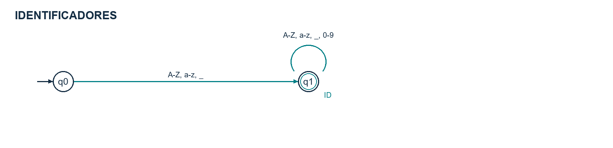
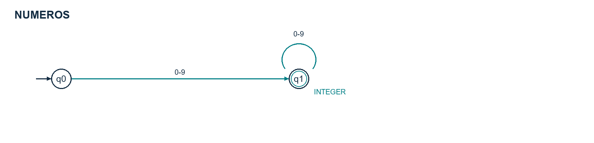
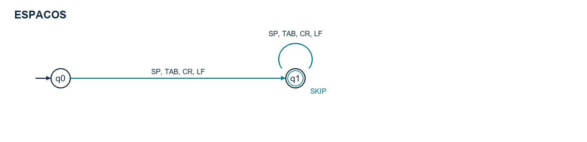
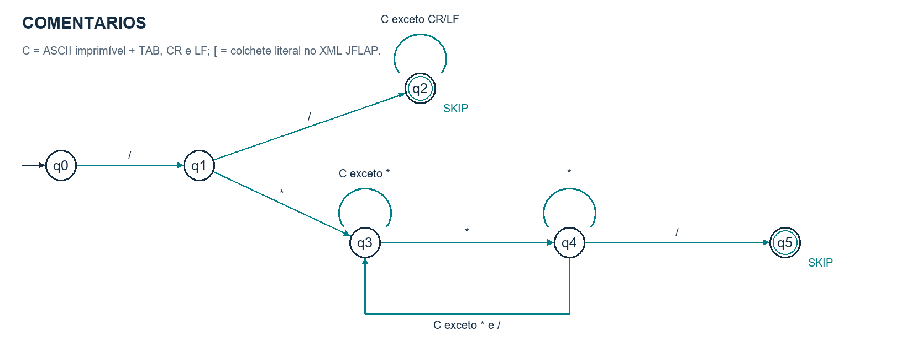
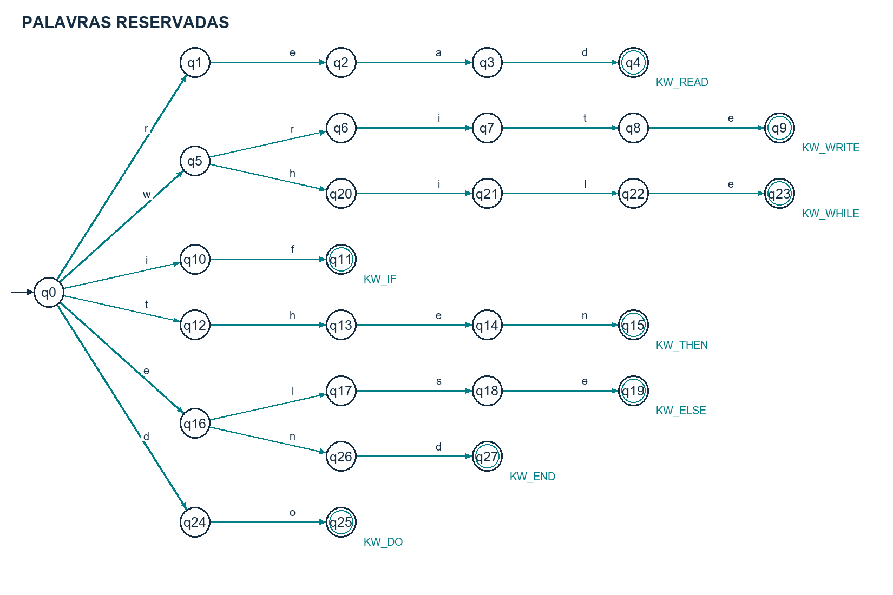
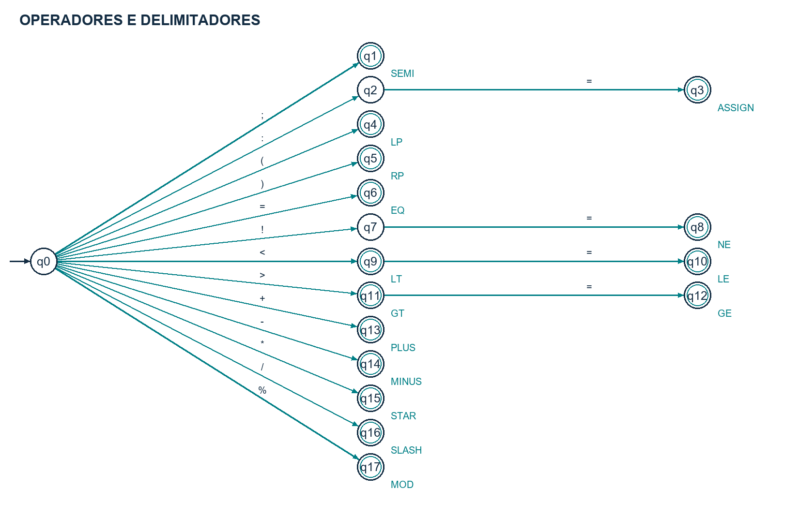

# MiniComp

## Interpretador MiniLang e relatório final

Programação em C++17 | Compiladores | Segunda entrega | 22/11/2026

### Resumo

O MiniComp implementa o front-end de uma linguagem imperativa de inteiros não negativos e sua execução por interpretação da árvore sintática abstrata (AST). A solução integra análise léxica por autômatos finitos, parser preditivo LL(1), recuperação de erros, tabela global de identificadores e avaliação dos comandos. A segunda entrega acrescenta inicialização global com zero, rastreamento com posições e evidência automatizada de testes.

O pacote inclui código-fonte, Makefile, README, gramática, FIRST/FOLLOW, tabela LL(1), seis autômatos editáveis no JFLAP, programas de demonstração e testes. A validação executada em Windows x86-64 aprovou 11 cenários da suíte original e 50 cenários adicionais. Esses resultados se referem à gramática adotada, não comprovam equivalência com uma especificação oficial ausente.

### Escopo e fonte dos requisitos

Foram usadas as descrições do projeto e das duas entregas fornecidas pelo aluno em capturas do portal. A segunda exige interpretador integrado à AST, variáveis globais inicialmente iguais a zero, atribuição, leitura, escrita, if-then-else, while-do, expressões, divisão por zero e rastreamento. Exige também relatório, tabelas, diagramas e testes de fatorial, máximo e soma até zero.

As capturas não trazem as produções originais nem a relação exata de tokens da MiniLang. Por isso, o relatório separa requisitos explícitos de decisões de implementação. Antes da submissão, a sintaxe deve ser comparada com eventual especificação adicional do professor. Não foi realizada submissão ao portal.

<!-- pagebreak -->

## 1. Fundamentos e arquitetura

Na análise léxica, caracteres são agrupados em tokens por linguagens regulares, reconhecidas por autômatos finitos. A análise sintática verifica a organização desses tokens segundo uma gramática livre de contexto. O parser LL(1) lê a entrada da esquerda para a direita, constrói uma derivação mais à esquerda e escolhe produções usando um token de antecipação. A tabela deve ter no máximo uma produção em cada célula.

A árvore concreta preserva a estrutura das produções; a AST elimina delimitadores e não terminais auxiliares. A execução utiliza essa representação sem repetir o reconhecimento sintático. A tabela global associa nomes a valores inteiros, e os diagnósticos preservam as posições do código original.

```text
Arquivo .ml -> scanner -> tokens com posição
                         |
                         v
                  parser LL(1) <- tabela gerada
                         |
                  árvore concreta
                         |
                      redução
                         |
                        AST
                         |
             inicialização global em zero
                         |
                   interpretador
                    /          \
             stdout: write   stderr: trace/erros
```

### Organização da implementação

| Componente | Arquivo | Responsabilidade |
| --- | --- | --- |
| Pipeline e CLI | src/main.cpp | Scanner, parser, AST, modos e diagnósticos. |
| Execução | src/interpreter.inc | Memória global, expressões, comandos e trace. |
| Gramática fonte | spec/grammar.json | Produções adotadas. |
| Gerador sintático | tools/generate-grammar.mjs | FIRST/FOLLOW, tabela e detecção de conflitos. |
| Gerador léxico | tools/generate-lexer.mjs | Mesma definição para scanner e arquivos JFLAP. |
| Testes | tests/run.mjs e interpreter.test.mjs | Contratos observáveis do executável. |

Os cabeçalhos gerados acompanham o projeto: compilar o executável exige C++17; regenerar tabelas e executar testes exige Node.js. O Makefile permite selecionar o compilador por CXX. Não há serviço externo, banco de dados ou dependência de rede durante a execução.

<!-- pagebreak -->

## 2. Especificação da linguagem adotada

Os identificadores seguem [A-Za-z_][A-Za-z0-9_]* e diferenciam maiúsculas de minúsculas. Inteiros são sequências de dígitos decimais. As palavras reservadas são read, write, if, then, else, while, do e end. O scanner reconhece :=, +, -, *, /, %, =, !=, <, <=, >, >=, ; e parênteses. Espaços e comentários // ou /* ... */ são descartados.

```text
read(n);
f := 1;
while n > 0 do
    f := f * n;
    n := n - 1;
end
write(f);
```

Esse programa lê um número e escreve seu fatorial, desde que o resultado caiba em 64 bits. Atribuições, read e write terminam em ponto e vírgula; if e while terminam em end. O else é opcional. Blocos e programas vazios são aceitos pela produção vazia da lista de comandos.

### Semântica e decisões

| Aspecto | Regra implementada |
| --- | --- |
| Domínio | Inteiros sem sinal de 64 bits, de 0 a 18446744073709551615. |
| Variáveis | Sem declaração explícita, escopo global e valor inicial zero. |
| Condições | Zero é falso; qualquer valor diferente de zero é verdadeiro. |
| Relações | Produzem 0 ou 1. Uma relação por Expr; relações aninhadas exigem parênteses. |
| Aritmética | Multiplicação/divisão/resto antes de soma/subtração; mesma precedência associa à esquerda. |
| Divisão | Inteira, descartando a parte fracionária; divisor zero gera erro. |
| Segurança numérica | Estouro, subtração negativa e literal/leitura fora do domínio geram erro. |
| Ordem | Comandos em sequência; operandos binários avaliados da esquerda para a direita. |

Os delimitadores e a largura numérica são decisões explícitas da implementação. Não há strings, ponto flutuante, funções, declarações locais, operador unário de sinal ou geração de código nativo. O executável hospedeiro é nativo; o programa MiniLang é interpretado.

<!-- pagebreak -->

## 3. Transformações da gramática e LL(1)

Uma produção recursiva à esquerda impede a escolha preditiva direta. Para a estrutura aritmética, usa-se uma transformação equivalente para reconhecer as mesmas sequências de operadores:

```text
Antes:  Simple -> Simple AddOp Mul | Mul
Depois: Simple -> Mul AddTail
        AddTail -> AddOp Mul AddTail | ε

Antes:  Mul -> Mul MulOp Primary | Primary
Depois: Mul -> Primary MulTail
        MulTail -> MulOp Primary MulTail | ε
```

Embora a cauda seja recursiva à direita, a construção da AST acumula operações à esquerda. Assim, 10 - 3 - 2 resulta em (10 - 3) - 2 = 5, e não 10 - (3 - 2). Os testes verificam essa diferença e a precedência de multiplicação.

O condicional possui duas alternativas com prefixo comum. A fatoração preserva o else opcional e usa end para delimitar o bloco, evitando a associação ambígua de else:

```text
Antes:  If -> if Expr then StmtList else StmtList end
           | if Expr then StmtList end
Depois: If -> if Expr then StmtList Else end
        Else -> else StmtList | ε
```

### Cálculo e preenchimento

FIRST contém os tokens que podem iniciar uma derivação. FOLLOW contém os tokens que podem aparecer depois de um não terminal; EOF pertence ao FOLLOW inicial. Os conjuntos são calculados até estabilizar. Para X -> α, coloca-se a produção nas colunas FIRST(α), exceto ε. Se α pode desaparecer, também se usam as colunas FOLLOW(X). O gerador aborta se duas produções ocuparem a mesma célula.

| Exemplo de célula | Justificativa |
| --- | --- |
| M[Primary, ID] = Primary -> ID | ID inicia essa alternativa. |
| M[AddTail, PLUS] = AddTail -> AddOp Mul AddTail | PLUS pertence a FIRST(AddOp). |
| M[AddTail, RP] = AddTail -> ε | RP pertence a FOLLOW(AddTail). |
| M[Else, KW_END] = Else -> ε | O else pode estar ausente antes de end. |

As 38 produções e todas as células não vazias constam de docs/grammar.md e do apêndice do PDF. As transformações acima explicam a gramática adotada; não são uma transcrição certificada das produções originais da disciplina.

<!-- pagebreak -->

## 4. Scanner, parser e construção da AST

O scanner testa os autômatos na posição atual e escolhe o maior prefixo aceito. No empate, palavras reservadas têm prioridade sobre identificadores. Dessa forma, if é palavra reservada, whilex é um identificador inteiro e <= não é dividido em dois tokens. Cada token guarda classe, lexema e posição inicial. CRLF é contado como uma única quebra de linha.

O parser mantém uma pilha de nós pendentes. Com um não terminal no topo, consulta a linha correspondente e a coluna do lookahead, expande a produção e empilha o corpo em ordem inversa. Com terminal no topo, compara e consome o token correspondente. Uma produção vazia não adiciona filhos.

### Recuperação e diagnósticos

Quando uma célula não existe, o parser registra o erro e busca um token aceito pela linha atual ou um delimitador de comando (SEMI, KW_ELSE, KW_END, EOF). Quando um terminal esperado não corresponde ao lookahead, registra sua ausência e prossegue sem consumir o token encontrado. Essa é uma estratégia de recuperação implementada; não há uma tabela separada de células sinc.

Uma análise com qualquer erro sintático não gera AST utilizável e não executa nem os comandos válidos anteriores ao erro. Isso evita efeitos parciais durante recuperação. Um erro léxico encerra o pipeline imediatamente. Erros semânticos interrompem a execução; as escritas anteriores já realizadas não são desfeitas.

```text
tests/invalid-semantic.ml:1:9: erro semântico: divisão por zero
```

### AST e execução

A redução da árvore concreta cria Program/Block, Assign, Read, Write, If, While, Binary, ID e INTEGER. Pontuação não é mantida como nó executável. Em Binary, a posição é a do operador, permitindo apontar a divisão que falhou.

Antes de executar, uma passagem pela AST coleta nomes em ID, Assign e Read e os inicializa uma única vez com zero. A coleta inclui ramos não executados. A execução usa a mesma memória global nos blocos e laços. A condição de while é reavaliada antes de cada iteração, inclusive para decidir a saída. Em read, a entrada só substitui o valor da variável depois de validada integralmente.

<!-- pagebreak -->

## 5. Rastreamento e exemplo verificável

O modo --trace executa o mesmo interpretador de --run e envia os eventos para stderr. Cada evento contém sequência, linha e coluna do comando ou identificador. Os resultados de write permanecem exclusivamente em stdout. O número do evento não é a contagem de instruções de máquina: inclui inicializações, decisões e resumo final.

```sh
echo 2 | ./minicomp --trace tests/trace.ml > resultado.txt 2> rastreamento.txt
```

Programa de demonstração:

```text
read(n);
while n > 0 do
    n := n - 1;
end
if n = 0 then
    write(n);
else
    write(99);
end
```

Saída esperada em resultado.txt: 0. A trilha completa, com entrada 2, é:

```text
[trace 1] 1:1 init n = 0
[trace 2] 1:1 read n: 0 -> 2
[trace 3] 2:1 while 1 -> body
[trace 4] 3:5 assign n: 2 -> 1
[trace 5] 2:1 while 1 -> body
[trace 6] 3:5 assign n: 1 -> 0
[trace 7] 2:1 while 0 -> exit
[trace 8] 5:1 if 1 -> then
[trace 9] 6:5 write 0
[trace 10] 1:1 final n = 0
[trace 11] 1:1 done
```

As posições dos eventos final e done são a posição do nó Program, não de uma nova instrução. Havendo erro semântico, os eventos anteriores e o diagnóstico permanecem; final e done não são emitidos. A suíte verifica sequência, posições, decisões dos ramos e separação de fluxos.

<!-- pagebreak -->

## 6. Validação e resultados

Os testes executam o binário compilado como processo separado, enviam entrada padrão e comparam saídas, diagnósticos e códigos de retorno. Isso valida a integração scanner -> parser -> AST -> execução. O timeout de cinco segundos pertence ao executor de testes e impede que uma regressão de laço bloqueie a suíte; o interpretador não limita o tempo do programa.

| Programa/caso | Entrada | Resultado verificado |
| --- | --- | --- |
| Fatorial | 5; também 0 | 120; também 1. |
| Máximo | 12 25; 25 12; 12 12 | 25; 25; 12. |
| Soma até zero | 2 5 9 0; também 0 | 16; também 0. |
| Inicialização global | Sem entrada | x e hidden começam em 0; x + 1 resulta em 1. |
| Precedência | 2 + 3 * 4; (2 + 3) * 4 | 14; 20. |
| Associatividade | 10 - 3 - 2; 20 / 2 / 2 | 5; 5. |
| Trace | 2 | stdout = 0; decisões, posições e memória em stderr. |
| Divisão/resto por zero | Divisor 0 | Diagnóstico semântico e código 1. |
| Limites numéricos | Máximo uint64 e operações fora do domínio | Máximo aceito; overflow e negativo rejeitados. |
| Entrada inválida | Ausente, texto, negativa, parcial e overflow | Diagnóstico, sem substituição por valor inválido. |
| Erro sintático | Operando/parêntese/end ausentes | Código 1 e nenhuma execução parcial. |
| Erro léxico e CRLF | Caractere @ ou comentário incompleto | Posição e categoria de erro verificadas. |

### Evidência e análise

Foram aprovados 61 cenários: 11 da suíte original e 50 adicionais. O arquivo docs/test-results.json registra horário UTC, plataforma, versão do Node e o nome/resultado dos 50 testes adicionais. O log da suíte original informa seus 11 cenários. A validação foi realizada em Windows x86-64 usando Zig C++ 0.15.2 e Node.js v24.15.0; o Makefile também foi executado com GNU Make para Windows. Não foi executado um ambiente Linux nesta revisão.

A avaliação dos testes encontrou diferenças de quebra de linha entre Windows e POSIX no executor de testes, resolvidas normalizando CRLF na comparação. Um comentário com acento foi rejeitado conforme a limitação ASCII já documentada; o teste válido passou a usar ASCII. Não foi ampliado o alfabeto do scanner sem alterar seus autômatos. Esses ajustes foram feitos antes da aprovação final da suíte.

Não são apresentados resultados de desempenho ou cobertura percentual, pois não foram medidos. Os casos automatizados verificam comportamento observável, inclusive erros esperados; não constituem prova formal de correção para todos os programas.

<!-- pagebreak -->

## 7. Limitações, decisões e requisitos

| Requisito da segunda entrega | Evidência no pacote |
| --- | --- |
| Interpretador integrado à AST | lower(syntax) e Interpreter.execute(ast). |
| Tabela global e zero padrão | Coleta prévia de nomes; tests/default-zero.ml. |
| Atribuição, leitura e escrita | executeNode e testes de execução. |
| Condicional e repetição | If/While, ramos verdadeiro/falso e aninhamento testados. |
| Expressões aritméticas e relacionais | evaluate; seis relações, precedência e limites testados. |
| Divisão por zero | Diagnóstico com posição; divisão e resto testados. |
| Rastreamento | --trace; tests/trace.ml e verificações automatizadas. |
| Fundamentação e transformações | Seções 1 a 4 deste relatório. |
| LL(1), FIRST/FOLLOW e JFLAP | docs/grammar.md, apêndice, diagramas e arquivos .jff. |
| Exemplos e análise de erros | Seção 6, programas .ml e suítes. |
| Makefile, README e testes | Incluídos na raiz e em tests/. |

### Limitações e consequências

- A sintaxe oficial completa ainda não foi fornecida: conferir principalmente :=, read/write com parênteses, end e ponto e vírgula antes da entrega.
- Inteiros são limitados a 64 bits e não negativos; por exemplo, fatorial de 21 ultrapassa esse domínio e deve produzir erro de overflow.
- Tokens, nomes e comentários têm alfabeto ASCII. A documentação é UTF-8. Os arquivos XML 1.0 JFLAP omitem form feed e tabulação vertical, que o scanner aceita como espaços.
- A recuperação sintática pode produzir diagnósticos em cascata e não corrige o programa. AST/execução são bloqueadas após erro sintático.
- O trace registra comandos, decisões e alterações de memória, não cada subexpressão isoladamente. Pode crescer indefinidamente em programas que não terminam.
- Não há otimização, bytecode ou geração de código de máquina MiniLang. A arquitetura executa a AST diretamente.
- O resultado da execução não tem rollback: saídas anteriores a um erro semântico permanecem.

### Conclusão

A implementação integra o reconhecimento léxico/sintático e a interpretação, com memória global inicializada, diagnósticos e rastreamento. Os testes confirmam os comportamentos definidos para os exemplos e casos de erro. A principal verificação externa pendente é comparar a gramática adotada com a especificação integral da disciplina. Os próximos anexos documentam os autômatos e a tabela usada pelo parser, permitindo reproduzir e inspecionar as decisões.

<!-- pagebreak -->

## 8. Reprodução dos resultados

Em um terminal POSIX com compilador C++17, GNU Make e Node.js, os comandos abaixo recompilam o projeto e executam as duas suítes. O código usa a biblioteca padrão e não depende de bibliotecas C++ externas.

```sh
make
make test
node tests/interpreter.test.mjs --report docs/test-results.json
echo 5 | ./minicomp --run tests/factorial.ml
echo '12 25' | ./minicomp --run tests/maximum.ml
echo '2 5 9 0' | ./minicomp --run tests/sum-until-zero.ml
./minicomp --run tests/default-zero.ml
```

Os resultados das quatro demonstrações são, respectivamente: 120; 25; 16; e três linhas com 0, 0 e 1. No Windows, o nome do executável é minicomp.exe. O Makefile reconhece Windows_NT e permite substituir CXX, inclusive por um comando de compilação compatível com C++17.

Para regenerar as tabelas e os arquivos JFLAP, execute make regenerate. Para reproduzir este PDF e seus diagramas, instale Pillow e ReportLab em Python e execute python tools/build-report.py. O script lê docs/relatorio.md, docs/grammar.md e os seis arquivos .jff. As fontes usadas são Arial/Consolas no Windows ou DejaVu no Linux. A geração de documentação não faz parte da compilação do interpretador.

Os autômatos também foram carregados pelo XMLCodec e simulados pelo FSAStepWithClosureSimulator do JFLAP, em Java 17, com 31 verificações: comentários (6), espaços (5), identificadores (5), números (5), operadores/delimitadores (5) e palavras reservadas (5). Entre as entradas estão colchetes literais em comentários, comentários sem fechamento, palavras reservadas com sufixo e operadores incompletos. Esses 31 casos são separados dos 61 testes do executável.

### Códigos de saída e inspeção

Sucesso retorna 0. Erros léxicos, sintáticos ou semânticos retornam 1; uso incorreto ou arquivo inacessível retorna 2. --tokens e --symbols executam somente o scanner, enquanto o modo padrão imprime a AST. --run e --trace exigem análise sintática sem erros. O arquivo docs/entrega-2.md reúne um roteiro curto para demonstração e os itens do pacote.

### Referências

1. Enunciados do projeto MiniComp e das duas entregas no portal Veritatis, fornecidos em capturas pelo aluno em novembro de 2026.
2. AHO, Alfred V. et al. Compilers: Principles, Techniques, and Tools. 2. ed. Addison-Wesley, 2006. Referência conceitual para scanner, LL(1) e tradução dirigida pela sintaxe.
3. Código-fonte e arquivos gerados deste projeto: spec/grammar.json, tools/generate-grammar.mjs, tools/generate-lexer.mjs e src/.
4. Artefatos de validação: tests/, docs/test-results.json e jflap/.

<!-- pagebreak -->

## Apêndice A. Diagramas dos autômatos JFLAP

Os diagramas abaixo são visualizações dos estados e transições dos arquivos .jff entregues, com transições de mesmo par de estados agrupadas em classes para legibilidade. Círculo duplo representa estado final; a seta de entrada identifica q0. Os arquivos JFLAP preservam as transições individuais. A prioridade entre autômatos é aplicada pelo scanner, não por estes diagramas isolados.

### Identificadores e números





### Espaços e comentários





### Palavras reservadas



### Operadores e delimitadores



## Apêndice B. Produções e tabelas completas

As produções, FIRST/FOLLOW e tabela LL(1) são geradas por tools/generate-grammar.mjs e estão em [grammar.md](grammar.md). A edição PDF inclui esse arquivo integralmente a seguir, com a numeração das 38 produções.
